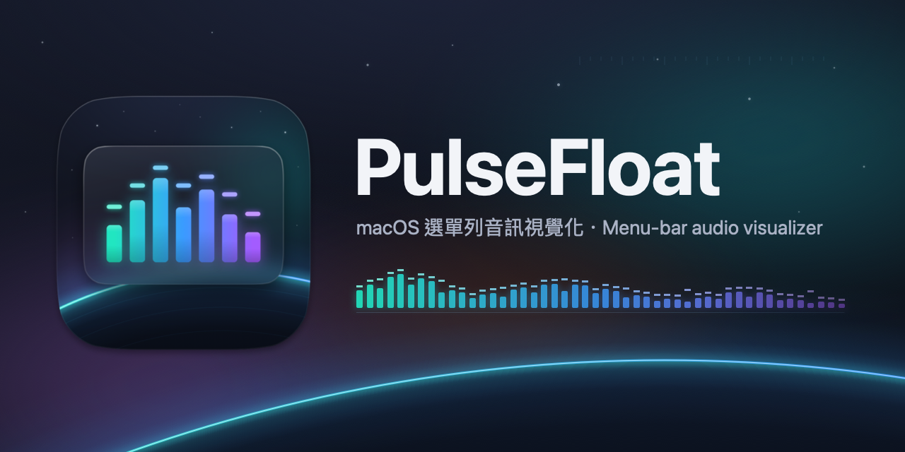

# PulseFloat



PulseFloat 是 macOS 選單列頻譜小工具，將系統播放的聲音呈現在桌面浮動視窗中。目前已完成 T01–T04：選單列迷你頻譜、四種主題的浮動視窗（毛玻璃／透明、可鎖定點擊穿透），以及用 Core Audio Process Tap 擷取系統音訊。

## 需求

- macOS 15 或更新版本
- Xcode 26
- XcodeGen

## 建置與測試

```bash
scripts/build.sh
scripts/test.sh
```

腳本可由任意工作目錄執行，會自動以 XcodeGen 產生專案，輸出至 `build/DerivedData`。測試使用無 host app 的 Core 測試套件，透過 `build-for-testing` 與 `xcrun xctest` 執行。

建置完成後，可開啟 `build/DerivedData/Build/Products/Debug/PulseFloat.app`；選單列提供「關於 PulseFloat」與「結束 PulseFloat」。

產品與技術規格見 [docs/SPEC.md](docs/SPEC.md)，實作任務位於 [docs/tasks/](docs/tasks/)。
