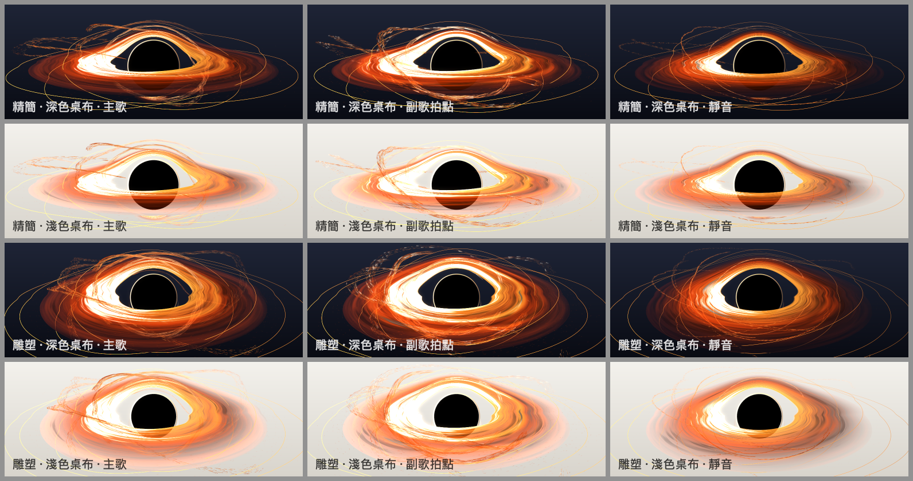
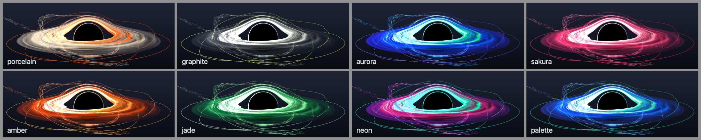
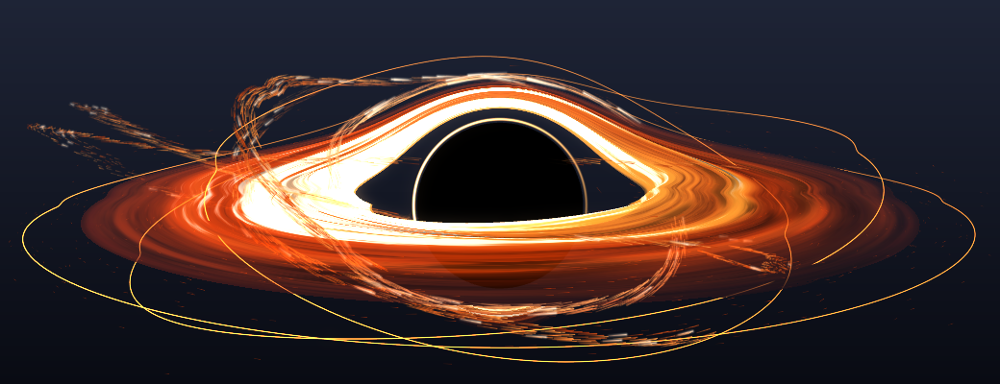
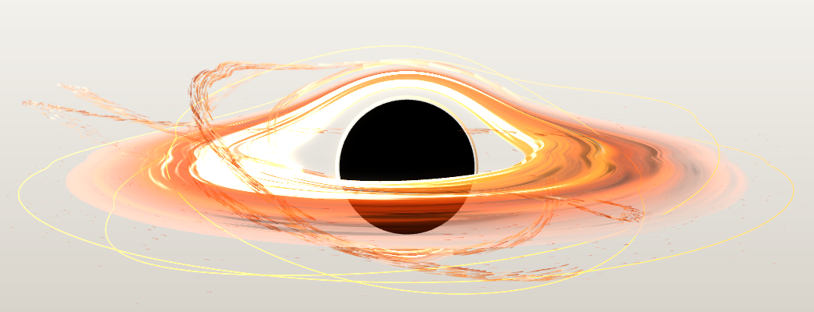
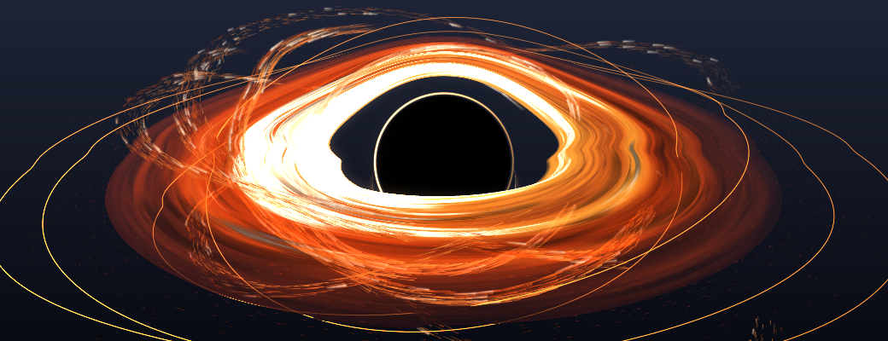
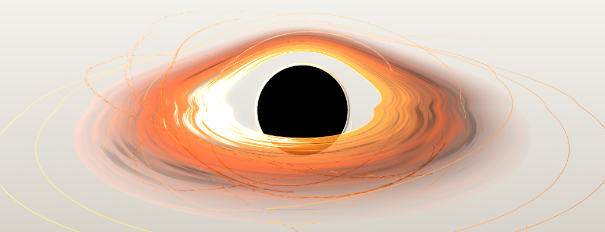

# 主題 A：黑洞（`blackhole`，`BlackHoleTheme`）

規格：[SPEC-3D.md](SPEC-3D.md)「THEME A」；共用架構：[README.md](README.md)。
所有截圖都是真正的 `SceneRenderer` 經過 `DemoAudio`（真實特徵引擎）算出來的（`scripts/shots.sh … --themes blackhole --styles --perf`），
不是概念圖。

## 1. 概念

「重力奇點」：一顆完全不透明的黑色陰影（事件視界），被一圈差速旋轉、內熱外冷的吸積盤包住；
盤面遠側被重力透鏡「抬」過陰影上方，形成電影裡熟悉的拱形，陰影邊緣貼著一條細細的光子環。
幾條克卜勒軌道上的粒子流像彗尾一樣繞著它，外圍有幾條會隨中頻變形的細環。
動作全部來自聲音：音量決定盤面轉多快、低頻撐開盤面並讓核心微微脈動、拍點從內緣送出一圈往外跑的光、
高頻在粒子流上打出短暫的火花；一靜音，所有東西停在最後的樣子。

## 2. 構圖

| 元素 | 做法 | 重點 |
|---|---|---|
| 事件視界 | `SCNSphere` r = 0.30，constant 黑色，不透明、寫深度 | 任何桌布上都是純黑（測試驗證 alpha = 255） |
| 吸積盤 | 極座標網格 r = 0.46…1.55（內圈加密），shader 算顏色、厚度、透鏡 | 部分不透明：條紋之間是暗色而不是透明，淺色桌布也看得到紋理 |
| 透鏡拱形 | 同一張盤面網格，在 vertex shader 對黑洞後方的頂點套點質量透鏡方程式 | **視覺近似**（見 §7）；遠側內緣被抬到陰影上方 |
| 次級像 | 盤面再畫一次，用透鏡的次級解並重新對應到陰影外緣的細環 | 強度隨對應程度 q³ 衰減 |
| 光子環 | 螢幕對齊的細環，半徑 1.045 × 陰影 | 射束側（左）較亮；低頻時變亮 |
| 粒子流 | 4–7 條軌道流（每條 300–1000 顆）+ 細塵 260–2200 顆 + 火花子集 | 每顆是沿運動方向拉長的圓頭小四邊形，位置由克卜勒方程式在 shader 算 |
| 細環 | 2–4 條帶狀細環（一條在盤面外緣、其餘傾斜 9–14°） | 螢幕等寬的帶子，同樣經過透鏡（遠側也會彎）；線寬至少約 2 px（小視窗不會斷成虛線，加寬時依覆蓋率調暗） |

浮動條固定約 2.6:1：精簡模式用長焦（fov 18°、距離 4.4）壓低透視，盤面約佔寬度 88%，拱形頂端離上緣還有空間。
雕塑模式仰角拉高、鏡頭靠近，粒子流與細環更多，鏡頭依音訊時鐘每秒環繞 3°。

## 3. 鏡頭

| 呈現方式 | `CameraPose` | 其他 |
|---|---|---|
| 精簡 compact | target (0, 0.05, 0)、distance 4.4、elevation 10°、azimuth 0、fov 18° | 固定鏡頭 |
| 雕塑 sculpture | target (0, −0.04, 0)、distance 4.0、elevation 21°、azimuth 0、fov 22° | `orbitSpeed` 3°/音訊秒；`pedestalRadius: nil`、`floorY −0.78` |

雕塑模式**不用台座、也不投影**：主體自己發光，底下出現主光的陰影反而顯得不對；黑洞漂浮在畫面中。
（舞台的陰影地面仍在，但沒有任何節點投影，所以是空的。）
盤面節點每幀轉向鏡頭的方位角（只在雕塑模式鏡頭環繞時改變），讓網格的「近側半圈」永遠最後畫；
shader 減掉這個偏航角，所以圖樣固定在世界座標，不會跟著鏡頭轉。

## 4. 材質、光線與 8 種風格

全部是自訂 shader 的不受光照材質（吸積盤本身就是光源）；「深度感」來自：射束（朝鏡頭運動的一側較亮）、
粒子越靠近中心越熱越亮、越遠離鏡頭越暗、半透明盤面蓋住盤後的粒子與細環、HIGH 才開的節制 HDR bloom
（`bloomIntensity 0.32`、`threshold 0.92`）。

吸積盤的顏色：`heat = (1−s)^1.6 × 紊流 + 脈衝`，沿 cool → mid → hot 漸層，只有最亮處（射束側內緣、脈衝）才轉白；
亮度用 `1 − e^(−1.4 I)` 的柔和曲線，亮處維持色相、不會截成整片白。塵帶是大尺度團塊上的暗色區域（吸光：不透明但暗），
在淺色桌布上提供深色結構。

| 風格 | 內緣 hot → 主體 mid → 外緣 cool | 細環／粒子 | 個性 |
|---|---|---|---|
| amber（預設） | 金黃 → 橘 → 深赭 | 淡金細環、金色粒子流 | 經典電影黑洞 |
| graphite | 銀白 → 石墨灰 → 深灰 | 萊姆色細環與火花 | 單色、金屬感，淺色桌布上像煙 |
| porcelain | 橘色餘燼 → 瓷白 → 灰米 | 橘色細環 | 白色釉面盤、內緣一圈橘 |
| aurora | 青綠 → 藍 → 紫 | 紫色細環 | 冷色 |
| sakura | 淡粉 → 櫻桃粉 → 莓紅 | 粉紅細環 | 柔和 |
| jade | 薄荷 → 翡翠 → 墨綠 | 淡綠細環 | 玉石 |
| neon | 青 → 洋紅 → 紫 | 青色細環、白色火花 | 霓虹、不透明度略低 |
| palette | 配色第一色（混白）→ 中間色 → 最後一色混中性灰 | 第一色細環 | 跟隨使用者配色；預設 aurora 配色時與 aurora 同色系，但核心更白、外圍更沉 |

**深色／淺色桌布**：黑色陰影是不透明的；盤面內圈不透明度 0.8–0.95，條紋間是暗色；粒子與細環都有自己的不透明度
（不是純加法光），所以在米白桌布上仍然是「暗底上的亮紋」。只有 bloom 是 alpha 0 的加法光（只在深色桌布上看得到）。

## 5. 音訊 → 畫面對應

| 訊號（`AudioFeatures` / `SpectrumFrame`） | 平滑 | 畫面 |
|---|---|---|
| `bass` | attack 0.05 / release 0.32 → `thickness` | 盤面厚度（單層網格的頂點往上推、以起伏近似厚度，螺旋密度波讓表面起伏）；螺旋密度波往內流的速度 `spiralPhase += (0.25 + 2.4·thickness)·dt·activity`（往內的能量流） |
| `bass − bassSlow`（瞬變） | attack 0.02 / release 0.2 → `core` | 黑色核心縮放 1 + 0.045·core、光子環變亮；持續低頻不會一直脈動 |
| `energy`、`level` | → `loudness` | 盤面亮度 1.0 + 0.4·loudness；盤面紊流轉速 `flowPhase += (0.42 + 0.55·energy + 0.45·thickness)·dt·activity` |
| `mid` | attack 0.08 / release 0.35 | 粒子流軌道起伏變形（徑向 7%、法向 7%）、細環上下起伏；變形相位速度 0.35 + 1.8·mid |
| `frame.values` 中頻三段（約 150 Hz–2 kHz） | attack 0.06 / release 0.3 → `harmonics` | 細環的 2、3、5 次諧波形狀 |
| `treble` | attack 0.02 / release 0.18 → `trebleGlow` | 細塵亮度（0.3 + 1.3·treble）、粒子流亮度 |
| `treble − trebleSlow`（瞬變） | attack 0.012 / release 0.14 → `spark` | 短暫火花：火花層 22% 的粒子閃亮，哪些粒子由 `floor(time·9)` 決定（音訊時鐘，不是亂數） |
| `onset` + `onsetEnvelope` × `bass` | 4 個脈衝槽，以 dt 老化 1.1 秒 | 一圈亮環從盤內緣往外傳（亮度 ×(1 + 2.2·pulse)、轉熱、微微鼓起），經過時把粒子往外推 |
| `balance` | attack 0.25 / release 0.3 | 盤面左右亮度／厚度不對稱（±30% / ±40%），整個系統傾斜 ±2° |
| `stereoWidth` | 平滑後傳進 shader | 保留給後續（目前沒有畫面用途） |
| `activity`、`time` | — | 所有相位只以 `dt × activity` 前進；軌道速率 → 粒子拖尾長度（靜音時縮到最短，約為最長的 1/4） |
| `isSilent` | 平滑值吸附到目標（2e-4），activity 為 0 後釋放加快 3 倍 | 3.5 秒內完全收斂 → `isAtRest`，之後逐像素不變 |

盤面紊流的差速旋轉：角速度 ∝ r^−1.5；用 flow map（兩組相位、每 6 單位交替）避免越捲越緊，相位 64 週期後折回。
粒子平均角速度量化到 1/8，軌道相位在 16π 折回時每顆粒子剛好轉整數圈（測試驗證）。

## 6. 效能

`scripts/shots.sh <dir> --themes blackhole --perf`（Release、1040×400 離屏、MSAA LOW 1× / 其他 4×）。
下表是審查時（細環最小線寬修正後）重量的結果；同一台機器上可能還有其他代理在跑，數字僅供參考，協調者整合後會重量。

| quality | presentation | CPU update | CPU encode | CPU total | GPU | silent CPU |
|---|---|---|---|---|---|---|
| low | compact | 0.02 / 0.03 | 0.19 / 0.27 | **0.21** / 0.31 | 0.14 / 0.44 | 0.00 |
| low | sculpture | 0.02 / 0.03 | 0.19 / 0.23 | **0.21** / 0.27 | 0.19 / 0.49 | 0.00 |
| medium | compact | 0.02 / 0.03 | 0.19 / 0.26 | **0.21** / 0.29 | 0.42 / 0.72 | 0.00 |
| medium | sculpture | 0.02 / 0.03 | 0.20 / 0.27 | **0.22** / 0.30 | 0.58 / 0.89 | 0.00 |
| high | compact | 0.02 / 0.03 | 0.22 / 0.30 | **0.24** / 0.34 | 0.71 / 1.01 | 0.00 |
| high | sculpture | 0.02 / 0.03 | 0.24 / 0.35 | **0.27** / 0.37 | 0.99 / 1.35 | 0.00 |

（中位數 / p95，毫秒。CPU = 主執行緒上的主題 update + SceneKit encode；GPU = command buffer 的 gpuEnd − gpuStart，分開量。）
Debug 共用測試：0.32 ms/幀。

做法：幾何只在 `apply` 改變畫質／呈現方式時重建；每幀 CPU 只做狀態平滑（SIMD、while 迴圈、無配置）、
黑洞縮放與傾斜、盤面偏航角，然後把 32 個數打包成兩個 `float4x4`（兩個 NSValue，所有材質共用；沒變就不設定）。
克卜勒軌道、透鏡、拖尾、紊流全在 shader。

| 風險 | 評估 | 預算／對策 |
|---|---|---|
| 盤面 fragment（fbm 2 組相位 × 2–4 層 + 團塊） | 中 | 噪聲層數 LOW 2 / MEDIUM 3 / HIGH 4；Retina 全螢幕寬時 GPU 約為上表 2–4 倍，仍在 60 fps 內 |
| 頂點數 | 低 | 盤面 LOW 3.7k – HIGH 24k 頂點 ×2（主像＋次級像）；粒子 4 頂點／顆，雕塑 HIGH 約 41k 頂點（盤後、盤前各處理一次） |
| 每幀 uniform | 低 | 2 次 KVC × 11 個材質，靜止時 0 次 |
| 透明圖層數 | 中 | 11 個 draw（盤後 4、盤面 2、光子環 1、盤前 4），一律單趟 |

## 7. 已實作、視覺近似、未來改進

**已實作**：上列所有構圖元素與音訊對應；8 種風格；精簡／雕塑兩種呈現；三種畫質（網格密度、噪聲層數、粒子數、細環數、HDR bloom 只在 HIGH）；
靜音凍結（共用測試＋主題測試驗證狀態完全不變、核心縮放歸 1、沒有脈衝）；異常 frame（NaN/∞）安全。

**視覺近似（不是物理正確）**：
- **重力透鏡**：把弱場點質量透鏡方程式 θ± = (β ± √(β² + 4θE²))/2 逐頂點套在黑洞中心平面後方的幾何上，
  偏折量隨深度以 b²/(b²+d0²) 平滑增加；次級像再重新對應到陰影外緣的細環。這**不是**廣義相對論的光線追蹤：
  沒有強場的多重像、光子環是手動放的細環、陰影大小與愛因斯坦半徑是美術參數，網格頂點之間是線性插值。
- **相對論性射束**：用 D = 1/(γ(1 − β cos α))、亮度 ∝ D^2.4，β = 0.42·√(r_in/r)，夾在合理範圍；沒有都卜勒頻移造成的色移。
- 盤面紊流、團塊、塵帶是程式噪聲，差速旋轉只是讓圖樣以 r^−1.5 的角速度平流。

**未來改進**：
- 真正的螢幕空間透鏡（把背景粒子與細環的扭曲做在後處理）、強場的多重光子環。
- 盤面的都卜勒色移（射束側偏藍、遠離側偏紅），以及溫度 → 黑體色的映射。
- `stereoWidth` 目前只傳進 shader 沒有使用，可以讓粒子流的傾角分布隨寬度張開。
- 使用者提到「有專輯圖片時放在圓環中間」：黑洞的陰影可以當作圖片的遮罩（例如陰影內淡淡顯示封面），
  但需要共用層提供封面圖（App 端的資料來源），而且會破壞純黑的剪影，需要另外決定。

## 8. SceneKit 實測（給其他主題參考）

- **透明材質的混合方式取決於 diffuse 的半透明從哪裡來**：
  - diffuse 是不透明顏色 → 材質被當成不透明，**不混合**，fragment 輸出直接覆寫像素（設 `blendMode` 也沒用）。
  - diffuse 是半透明的「純色」→ 用材質常數的不透明度混合（像是 blend constant），**fragment 輸出的 alpha 被忽略**：
    即使輸出 alpha 0 也會把底下壓暗 (1 − diffuse alpha)。
  - diffuse 是半透明的**貼圖**（這裡用 1×1 的 CGImage）→ `.alpha` 變成 premultiplied over `(one, 1 − srcAlpha)`，
    使用每個 fragment 的 alpha。這是本主題所有 shader 材質的做法（`BlackHoleShaders.material`）。
  - `.add` 是 `(one, one)`（顏色與 alpha 都是）。
- shader modifier：`uniform` 宣告前面若有其他程式碼會編譯失敗，改用 `#pragma arguments`；可以在 `#pragma body` 前定義函式
  （同一個材質的兩個 entry point 會在同一個檔案，要用 `#ifndef` 防重複）；`#pragma varyings` 可用；`float4x4` 參數用
  `NSValue(scnMatrix4:)`，第 k 欄 = (m(k+1)1 … m(k+1)4)；`scn_node.inverseModelViewTransform` 可用。
- shader 編譯錯誤不會出現在 stdout：執行時加 `OS_ACTIVITY_DT_MODE=YES` 才會把 SceneKit 的錯誤印出來（失敗時畫面是洋紅色）。

## 9. 探索過程（截圖迭代摘要）

1. 原型：近距離廣角、盤面 + 透鏡拱形一次就出來，但透視太強（近側盤面佔滿下半）、盤面像霧、拱形像灰色布料、粒子是方塊。
2. 改長焦、柔和色調曲線、細條紋、粒子改成拖尾四邊形；發現音樂時大部分亮度來自重疊的脈衝，靜音畫面變得黯淡 → 脈衝改成細環、基準亮度提高。
3. 粒子在盤面上打出洞 → 追到 SceneKit 的透明分類與混合方式（§8），改成貼圖型半透明 diffuse，單趟 premultiplied over。
4. 細環在穿過黑洞中心平面處有折角 → 透鏡深度權重改成 C1 平滑；雕塑模式盤面轉向鏡頭；淺色桌布上的白化與外圈灰霧調整。

| 精簡 · 深色 · 副歌 | 精簡 · 淺色 · 副歌 |
|---|---|
|  |  |
| **雕塑 · 深色 · 副歌** | **雕塑 · 淺色 · 靜音** |
|  |  |

## 檔案

- `PulseFloatScene/Themes/BlackHoleTheme.swift`：主題、`BlackHoleLayout`（畫質／呈現方式的配置）。
- `PulseFloatScene/Themes/BlackHole/BlackHoleShaders.swift`：所有 shader modifier 與材質工廠。
- `PulseFloatScene/Themes/BlackHole/BlackHoleAudioState.swift`：音訊狀態（純值型別，可單獨測試）。
- `PulseFloatScene/Themes/BlackHole/BlackHoleMeshes.swift`：網格與可重現的粒子／軌道配置。
- `PulseFloatScene/Themes/BlackHole/BlackHolePalette.swift`：8 種風格的配色。
- `PulseFloatScene/Themes/BlackHole/BlackHoleLayer.swift`：一個 shader 圖層（節點＋材質）。
- `PulseFloatSceneTests/BlackHoleThemeTests.swift`：12 個主題測試。
