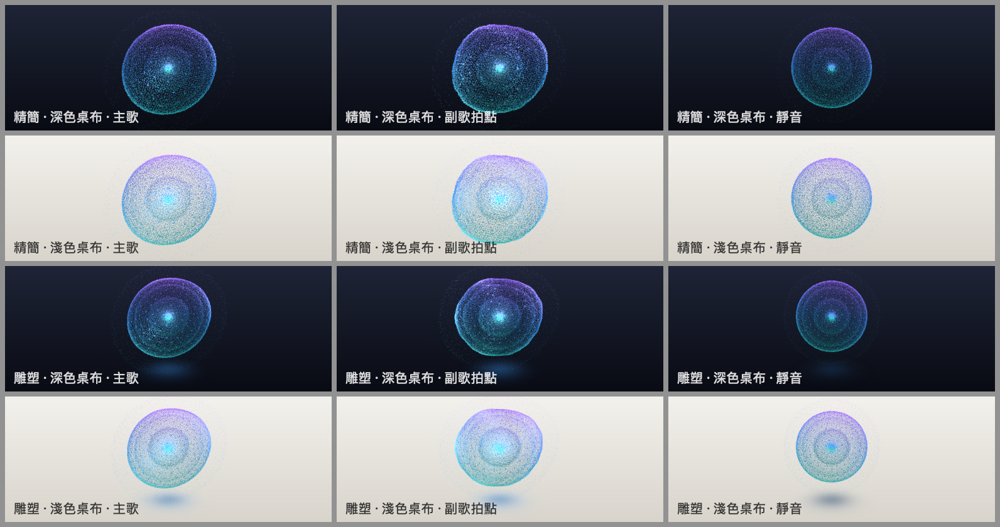
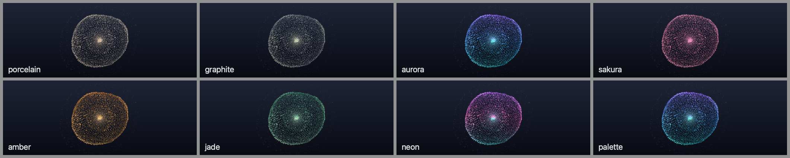
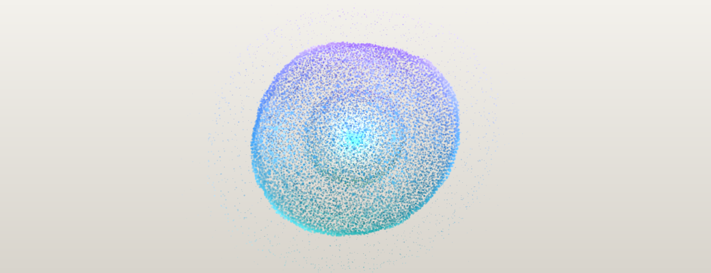
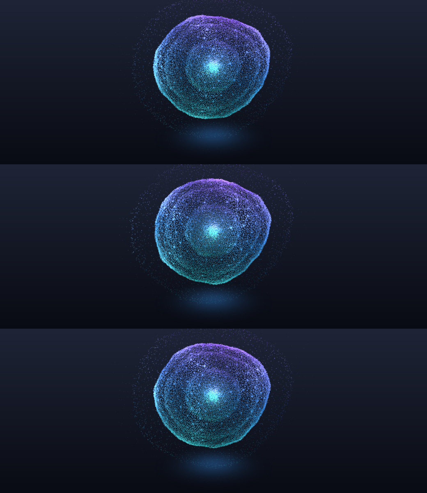

# 粒子球（Particle Sphere）— 設計探索與實作紀錄

主題 id：`particles`（`ThemeID.particleSphere`），類別 `ParticleSphereTheme`。規格見 [SPEC-3D.md](SPEC-3D.md) 的 THEME B，
共用架構見 [README.md](README.md)。所有截圖都是真正的 `SceneRenderer`（`scripts/shots.sh`，Release）輸出，不是概念圖。

*列：精簡／雕塑 × 深色／淺色桌布；欄：主歌、副歌拍點、靜音（4 秒後，逐像素靜止）。預設風格 aurora，HIGH。*

## 1. 概念

一顆「活的能量生物」：決定性的分層粒子結構（不是每顆粒子各自亂動），像細胞或星雲一樣有核心、膜與外圍大氣。
聲音不讓粒子亂跳，而是讓整個結構**呼吸**（低頻）、**局部鼓起**（中頻，球諧變形）、**表面顫動**（高頻）、
**被心跳貫穿**（起音：一道由核心往外、再沿球面擴散的波前）。安靜時它是一顆完美、靜止的球。

## 2. 視覺構成

| 層 | 半徑 | 分佈 | 作用 |
|---|---|---|---|
| 核心光暈 | 0 | 1 個寬的柔和光點（染色為主、加法光為輔） | 亮的內核；起音／低頻時變亮變大 |
| 核心光團 | 0.05–0.31 | 體積分佈（費氏方向 × 雜湊半徑，越內越密） | 熱點（熱色），深度感 |
| 內殼 | 0.5 ± 0.035 | 費氏晶格＋決定性切向／徑向抖動 | 隔著主殼看到的第二層（畫面上的內圈） |
| 第二殼（MEDIUM/HIGH） | 0.84 | 同上，較暗 | 密度層次 |
| 主殼 | 1.0 ± 0.012 | 費氏晶格＋抖動（打散螺旋疊紋），約 7% 是較亮的閃點 | 主要的形體與剪影 |
| 星座節點＋連線 | 1.0 | 稀疏費氏晶格；相鄰節點以 1 px 細線相連（`i ± F_k` 鄰居，保留 55–70%） | 連線亮度隨局部能量，能量高的區域浮現網路 |
| 外殼 | 1.34 | 稀疏晶格 | 淡淡的外膜 |
| 外圍塵埃 | 1.1–1.75 | 體積分佈，越外越暗 | 大氣、對低頻與起音反應最大 |
| 地面光池（只在雕塑） | 地面 y = −1.62 | 水平平面＋徑向衰減 | 深色桌布上是球照亮地面的光，淺色桌布上是接觸陰影 |

粒子數（`ParticleSphereRecipe`，不含連線端點）：

| | LOW | MEDIUM | HIGH |
|---|---|---|---|
| 精簡 | 1,991（約 156 條連線） | 6,981（約 378） | 17,901（約 671） |
| 雕塑 | 2,981（約 207） | 11,961（約 573） | 33,661（約 1,068） |

精簡模式粒子較少、點較大，剪影乾淨；在最小視窗（364×140 px）仍然清楚。點的大小有 0.7 px 下限，
過小時以覆蓋率補償亮度（面積守恆），所以小視窗不會變成一團實心球。浮動條是 2.6:1，球置中、光暈幾乎碰到上下緣；
左右留白是刻意的「珠寶」構圖（見「未來改進」）。

## 3. 相機（`CameraPose`）

| 呈現 | target | distance | elevation | azimuth | fov | 其他 |
|---|---|---|---|---|---|---|
| 精簡 | (0, 0, 0) | 6.4 | 6° | 0° | 28° | 固定 |
| 雕塑 | (0, −0.36, 0) | 6.8 | 13° | −8° | 30° | 地面 −1.62、無台座、`orbitSpeed` 3°/音訊秒（靜音停止）；使用者拖曳／縮放由 `SceneStage` 處理 |

不使用共用台座（`pedestalRadius: nil`）：這是一個漂浮、發光的能量體，接地感改由自己的地面光池提供
（深色桌布上是光、淺色桌布上是接觸陰影）。附註：快速試了 `pedestalRadius: 0.95`（地面 −1.62），離屏截圖裡看不到台座，
拿掉下面兩項覆寫也一樣；原因沒有深入追查（共用 `SceneStage` 不在這個任務的範圍），已在回報中提出。
粒子不投射陰影，所以主題關掉主光的陰影貼圖與共用的只收陰影地面（省一個繪製階段，也避免陰影取樣的雜訊）。

## 4. 材質與光照

**一個材質、一個幾何、兩個 element**（圓點三角形＋連線），全部在 Metal shader modifier 裡：

- **頂點階段**：晶格自轉 → 變形場座標 → l ≤ 4 實球諧場（24 個係數）＋高頻細振動＋起音波前 → 徑向位移；
  然後把每顆粒子的 4 個頂點沿鏡頭的右／上方向展開成面向鏡頭的圓點（用 `scn_frame.inverseResolution` 算每單位像素數）。
- **顏色**在頂點階段算好，premultiplied：`rgb = 本體色 × α + 光色 × 發光量`。
  - **本體色**（遮蓋）一律壓到中深色調（亮度 ≤ 96，往該風格的深色文字／外框色混），所以**淺色桌布**上是清楚的有色點描；
  - **光色**（加法光）比遮蓋小，只有能量高（球諧鼓起、脈衝、閃點）的地方才真正發亮，**深色桌布**上是發光的球。
  - 遮蓋主要由深度決定（背面 0.4、正面 1），光照只影響發光：假的主光（`SceneStage` 主光方向）× 深度 → 體積感；
    主殼與外殼有 fresnel 輪廓光，球的邊界清楚。
- **片段階段**只乘上圓點輪廓（中心平台、邊緣快速收掉）或光暈輪廓；線條直接輸出。
- **bloom** 只在 HIGH：`bloomIntensity 0.18`、門檻 0.9（bloom 是 alpha 0 的加法光，淺色桌布上看不到，所以不能依賴它）。

8 種風格（`ParticleSpherePalette`，由 `SceneLook` 推導，沒有另一套色彩偏好）：

| 風格 | 光色漸層（低→高） | 熱色 | 說明 |
|---|---|---|---|
| porcelain | 暖米白 | 琥珀橘（accent） | 深色桌布上是瓷白發光點，淺色桌布上是暖灰點描 |
| graphite | 冷銀灰（偏暗） | 萊姆（accent） | 與 porcelain 明顯區分：冷、暗、萊姆熱點 |
| aurora | 青 → 藍 → 紫（`look.glow`） | 白 | 預設截圖風格 |
| sakura / amber / jade | 各自的三色漸層 | 各自的 pulse 色 | 本體色往深色文字色混 |
| neon | 青／洋紅／紫 | 白 | |
| palette | 目前配色的三個點 | `look.pulse` | 跟隨使用者配色 |

## 5. 音訊 → 視覺對應

全部來自 `SpectrumFrame`（共用特徵引擎，沒有第二次 FFT）；CPU 每幀只做 24 個係數與少量平滑，送 5 個 `float4x4` uniform。

| 輸入 | 處理（`ParticleSphereDynamics`） | 視覺 |
|---|---|---|
| `features.bass`、`features.level` | `0.13·bass + 0.035·level`，attack 35 ms／release 220 ms | 整顆球膨脹（外圍塵埃反應最大、核心最小）；地面光池變亮 |
| `frame.values`（64 頻段，依頻率位置 0…1 分組） | 24 個三角形頻率窗：低音 → l=1（3），中低頻 → l=2（5），中頻 → l=3（7），中高頻 → l=4（9）。每窗取「比整體平均突出多少（對比）＋比自己 1 秒平均多出來多少（新奇）」，乘上固定的正負號與每階增益；總和超過 0.22 後軟限制。attack 60 ms／release 320 ms | 平滑的局部鼓起與凹陷；**同一段頻率永遠推動同一塊區域**（頻率分佈 → 球面不同區域），低頻是大區塊、高頻是細紋；鼓起處變亮並偏向熱色，連線浮現 |
| `features.treble` | 振幅 `0.022·treble`；相位 += dt·activity·(2.4 + 5.5·treble) | 表面細振動（空間上連續的細紋，不是每顆粒子亂數）＋細碎閃光 |
| `features.onset`、`onsetEnvelope` | 產生脈衝（最多 4 個），起點 = 目前球諧場最鼓的方向（偏向鏡頭側），強度 = envelope；壽命 1.5 s、波前速度 2.1/s | 波前由核心往外，先點亮起點，再以環狀沿球面擴散到外圍；經過處粒子變亮、外推 |
| `onsetEnvelope`、`bass`、`level` | 核心亮度 | 核心光暈與光團變亮、變大 |
| `features.energy` | 晶格自轉速度（dt·activity·(0.05 + 0.11·energy)） | 粒子結構緩慢自轉（變形場相對固定，粒子流過鼓起處） |
| `features.mid` | 變形場座標緩慢旋轉（dt·activity·(0.025 + 0.07·mid)） | 鼓起的位置緩慢漂移 |
| `features.activity`、`isSilent` | 所有相位、自轉只隨 `dt × activity` 前進；靜音時目標全為 0 | 靜音 → 收斂到完美的球後逐像素靜止 |
| `features.time` | `SceneStage` 雕塑鏡頭環繞 | 雕塑模式的緩慢環繞（靜音停止） |

## 6. 靜音

- 所有平滑狀態（24 個係數、膨脹、細振動振幅、核心亮度）在差距 < 4e-4（約 0.05 px）時直接等於目標；
  靜音時目標精確為 0、慢速平均直接歸零、脈衝在 1.5 s 內結束。測試（`testSilenceFreezesAndSettlesAllState`）確認
  示範音樂後靜音 3.5 秒內全部收斂；共同契約測試在靜音 4 秒後檢查 `isAtRest` 與逐像素靜止。
- 靜止後 `update` 不再設定任何 uniform；畫面是一顆完美的球（自轉角停在最後的位置）。
- 沒有牆上時間、`u_time`、`SCNParticleSystem`、`SCNAction`、`SCNAnimation`、隱式交易動畫，沒有每幀亂數。

## 7. 效能

Release、1040×400、離屏（GPU 等該幀完成，精確到該幀；CPU 與 GPU 分開量）。其他代理同時在這台機器上建置／渲染，數字僅供參考。

| quality | presentation | CPU update | CPU encode | CPU total | GPU | 靜音 CPU |
|---|---|---|---|---|---|---|
| low | compact | 0.01 / 0.02 | 0.07 / 0.18 | 0.08 / 0.21 | 0.03 / 1.08 | 0.00 |
| low | sculpture | 0.01 / 0.02 | 0.09 / 0.23 | 0.10 / 0.27 | 0.04 / 1.16 | 0.00 |
| medium | compact | 0.01 / 0.01 | 0.07 / 0.13 | 0.08 / 0.15 | 0.08 / 1.20 | 0.00 |
| medium | sculpture | 0.01 / 0.02 | 0.09 / 0.13 | 0.10 / 0.15 | 0.14 / 1.43 | 0.00 |
| high | compact | 0.01 / 0.02 | 0.10 / 0.16 | 0.11 / 0.17 | 0.24 / 1.36 | 0.00 |
| high | sculpture | 0.01 / 0.03 | 0.12 / 0.25 | 0.13 / 0.28 | 0.39 / 1.47 | 0.00 |

（中位數 / p95，毫秒。GPU p95 的尖峰來自同機其他代理的 GPU 工作。）

**風險評估與預算**

| 風險 | 等級 | 對策 |
|---|---|---|
| 粒子數（HIGH 雕塑 3.4 萬顆 = 13.5 萬頂點） | 低 | 一個 draw call 的四邊形；頂點著色器簡單（約 60 次乘加＋4 次 acos）；實測 GPU 0.4 ms |
| 每幀 CPU | 低 | 24 個係數 × 64 頻段的加權平均＋5 次 KVC 設定；不重建幾何、陣列就地修改、熱路徑只用 `while` |
| 透明混合的過度繪製 | 中 | 點很小、無深度寫入；精簡模式粒子較少；LOW 關 MSAA |
| 首次繪製編譯 shader | 中 | 一次性約 10–180 ms（不計入每幀）；換風格不重建幾何，只換畫質／呈現方式時重建 |
| 每幀配置 | 低 | 唯一的每幀配置是 SceneKit KVC 需要的 `NSValue` 包裝（5–6 個小物件）；靜音時為 0 |

預算：LOW（精簡 2k / 雕塑 3k 粒子、MSAA 1×、無 bloom）、MEDIUM（7k / 12k、MSAA 4×）、HIGH（18k / 34k、MSAA 4×、淡 bloom）。
CPU 中位數全部 < 0.2 ms（目標 < 2 ms）。

## 8. 截圖

| | |
|---|---|
|  |  |
| 雕塑 HIGH、深色桌布、副歌：細粒子、輪廓光、內圈、外殼、地面光池 | 精簡 HIGH、淺色桌布：有色點描＋清楚的剪影 |
|  |  |
| LOW 精簡：粒子少時星座連線最明顯 | 副歌拍點後 0 / 0.1 / 0.2 秒：膨脹、波前經過處變亮、地面光池閃一下 |

## 9. 實作、近似與未來改進

**已實作**

- 分層決定性粒子結構（核心光暈、核心光團、內殼、第二殼、主殼、節點＋連線、外殼、塵埃），三種畫質 × 兩種呈現方式。
- l ≤ 4 實球諧變形（24 係數，頻率區段 → 階數與區域）、低頻膨脹、高頻細振動、起音波前、核心亮度、晶格與變形場的音訊驅動旋轉。
- 深淺兩種桌布都清楚的 premultiplied 本體＋發光模型；8 種風格；雕塑模式地面光池／接觸陰影；HIGH 的淡 bloom。
- 靜音收斂與逐像素靜止、`isAtRest`；15 個主題專屬測試＋共同契約測試。

**視覺近似（不是物理模擬）**

- 光照是 shader 裡的假光（主光方向 × 深度 × fresnel），粒子不受 SceneKit 燈光影響；地面光池是徑向漸層，不是真正的光傳遞。
- 「波前」是沿固定路徑長（半徑＋角距離）傳播的高斯環，不是波動方程。
- 粒子沒有排序（透明混合順序固定）；點很小所以看不出來，但嚴格說背面粒子可能畫在正面之上。

**未來改進**

- 2.6:1 的左右留白：可考慮雕塑模式加上沿偶極磁力線流動的稀疏粒子（磁層），讓構圖往兩側延伸（要避免和黑洞主題的軌道環重複）。
- 起音波前可以再明顯一點（目前刻意節制）；或依 `balance` 讓起點偏左／偏右（立體聲）。
- 用 `MTLBuffer` 取代 KVC uniform，連每幀的 `NSValue` 包裝都省掉。
- 在 PulseFloatShots 加入時間序列輸出（這次用暫存的工具看動態）。

## 10. 開發中確認的 SceneKit 事實（給其他主題參考）

- **自訂 `#pragma arguments` 太多會悄悄壞掉**：每個參數各佔一個 buffer slot；28 個 `float4` 加上 SceneKit 自己的 buffer
  超過頂點階段 31 個上限時，**沒有任何錯誤訊息**，幾何直接塌掉或不畫。改成 7 個 `float4x4`（`NSValue(scnMatrix4:)`，
  Metal 端 `m[i]` = SCNMatrix4 的第 i 列 `m_i1…m_i4`）就正常。
- `#pragma varyings`（`out.x` / `in.x`）、`_geometry.color`、`_geometry.texcoords[0]`、`scn_frame.inverseResolution`、
  `scn_node.inverseModelViewTransform` 在離屏 `SCNRenderer` 都可用。
- `blendMode = .alpha`＋`transparency = 0.999` 的混合是 premultiplied（ONE, ONE_MINUS_SRC_ALPHA）：`_output.color` 的 rgb 可以大於 alpha（遮蓋＋加法光一次完成）。
- `_output.color` 直接寫進 BGRA8，沒有 gamma 轉換，所以 uniform 顏色用 sRGB 0…1。
