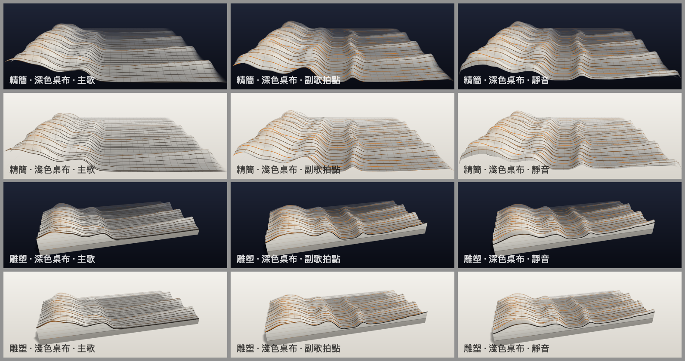
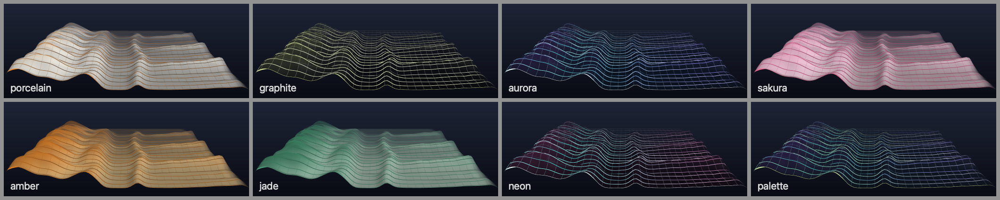
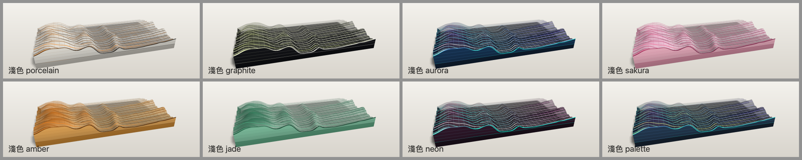
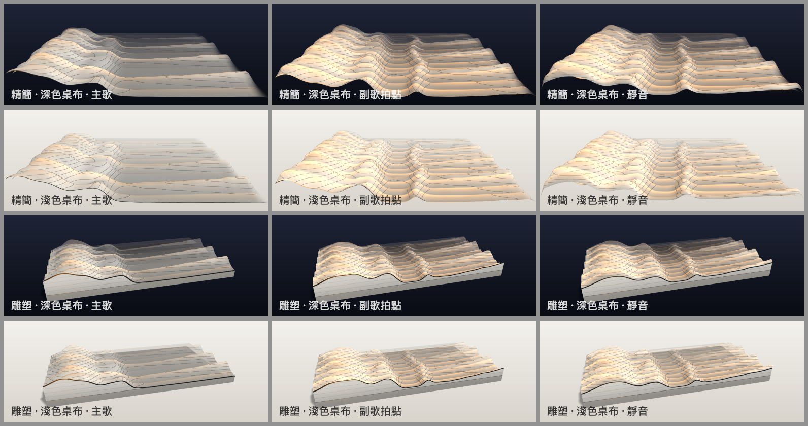
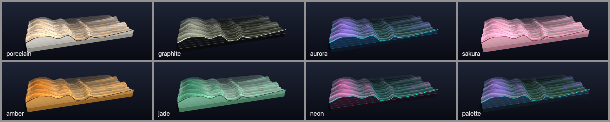
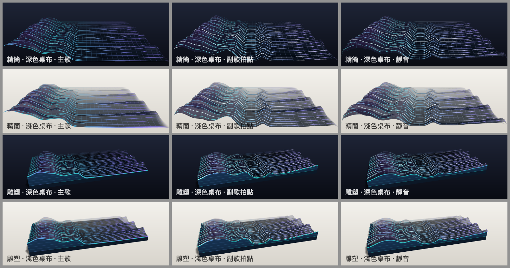

# 主題 C：音訊地形（Audio Terrain，`terrain`）

規格：[SPEC-3D.md](SPEC-3D.md) 的 THEME C；共用架構：[README.md](README.md)。
程式：`PulseFloatScene/Themes/TerrainTheme.swift`、`PulseFloatScene/Themes/Terrain/*`；測試：`PulseFloatSceneTests/TerrainThemeTests.swift`。

所有截圖都是真正的 `SceneRenderer`（Release）經過真實特徵引擎（`DemoAudio`）畫出來的，不是概念圖。



## 1. 概念

「光譜地景」：一張會呼吸的地形模型。左右是對數頻率（低音在左），前後是時間（新的頻譜切片從最前緣長出來、往遠方退去），
高度是能量。持續的音色（貝斯、和弦墊音、主旋律）連成往地平線延伸的山脈；鼓點在山脈上推出一道道漣漪，
並在當時的切片留下強調色的「鼓點線」，跟著地形一起退到遠方，成為看得見的節奏紀錄。

兩種外觀（`SceneSettings.terrainSurface`）：

| 外觀 | 樣子 |
|---|---|
| `.wireframe` 線框地景 | 抗鋸齒細線組成的格網：時間切片線（每條就是一個歷史頻譜）、較淡的頻率格線、加粗的前緣線（即時頻譜）。線下有帶 alpha 的填色做隱線與景深，深淺桌布都看得清楚。 |
| `.surface` 平滑半透明曲面 | 有光照的半透明曲面：高度漸層、菲涅耳邊緣、柔和高光與等高線（地形圖的等高線），鼓點變成曲面上微微發亮的帶子。 |

## 2. 構圖與鏡頭

浮動條固定約 2.6:1（寬扁），兩種呈現方式都為這個比例構圖。鏡頭位置是用投影計算解出來的（前緣、地平線、山峰在畫面中的位置），
不是猜的。

| | 精簡 compact | 雕塑 sculpture |
|---|---|---|
| 構圖 | 低角度沿時間軸看過去，前緣幾乎貼齊畫面下緣並稍微超出左右邊，地平線在上方約 30% 處；左右兩側壓平並淡出，像一片延伸到畫外的地景。沒有台座。 | 「立體模型（diorama）」：地形放在有厚度的台座上，四周是切開的剖面——正面切面就是即時頻譜的剪影，左側切面是低頻的歷史剖面；剖面上有地層線與地面線。台座直接坐在只收陰影的透明地面上（接觸陰影）。 |
| 地形尺寸（寬 × 深 × 高） | 3.6 × 3.0 × 0.55 | 2.8 × 1.6 × 0.40，台座厚 0.10 |
| `CameraPose` | target (0, −0.36, −0.1)、distance 4.0、elevation 23°、azimuth 0°、fov 30° | target (0, −0.25, 0)、distance 3.9、elevation 27°、azimuth −10°、fov 26°（審查修正：原本 target y = −0.02，模型偏低、擺動時台座前角被畫面下緣切掉；現在垂直置中，±6° 擺動時上下仍有餘裕） |
| 動態 | 鏡頭固定 | 舞台環繞關閉（orbitSpeed 0），改成模型本身隨音訊時鐘左右擺動 ±6°（週期 38 音訊秒）：寬扁畫面裡模型不會轉到側面而變窄，燈光固定、高光在表面滑動，像轉台上的雕塑。 |
| 使用者操作 | — | 拖曳／縮放走舞台共用的 `setUserCamera`（靜音時也可以改變鏡頭） |

## 3. 材質與光照

- **自己的著色**：材質用 `.constant` 光照模型，光照全部在 fragment modifier 裡算：半球環境光、包覆式漫射的斜射主光（跟舞台主光同在右前上方，
  所以和雕塑模式的落影一致，但壓低成斜射，沿時間軸延伸的山脈左右兩面明暗分明）、舞台補光、Blinn 高光、菲涅耳、谷底遮蔽（依高度）、景深淡出。
  理由：輸出貼圖是 bgra8Unorm 而 SceneKit 不做 gamma 編碼（見 §9），自己算才能讓顏色在顯示空間裡準確，也比 PBR + 透明更好控制。
- **景深**：越遠 alpha 越低（premultiplied），在深色與淺色桌布上都自然地「霧化」到背景色；時間切片線太密時先只留每隔一條、再淡出。
- **後緣**：最後 30% 深度高度平滑降到 0，舊歷史像被侵蝕的平原，後緣永遠是一條乾淨的地平線（也讓環狀緩衝重用最舊列時沒有跳動）。
- **隱線**：三角形由後往前排列，半透明填色由後往前疊，前面的山擋住（調暗）後面的線。
- **bloom**：評估後不開。實測 `wantsHDR` 時靜音的兩幀不是逐像素相同（違反靜音規則），而且細線本身已經夠亮。

### 8 種風格

兩個家族都以 alpha 覆蓋的填色為主體（不是純加法光），所以在淺色桌布上不會消失：

| 家族 | 風格 | 線框 | 曲面 | 雕塑切面 |
|---|---|---|---|---|
| 亮色（`SceneLook.isLight`） | 白瓷（預設）、櫻花、琥珀、翡翠 | 淺色半不透明填色（白色建築模型），墨色線（`SculptureStyleColors.ink`），峰頂線偏強調色，鼓點線用強調色 | 有光照的淺色曲面、墨色等高線、峰頂暖色 | 淺色剖面、墨色輪廓與地層線 |
| 深色 | 石墨、極光、霓虹、配色 | 深色玻璃般的填色，發光的彩色線（沿頻率軸低 → 高走風格的光色漸層，峰頂再偏向峰頂色），鼓點線用脈衝色 | 深色到光色的半透明曲面、彩色等高線 | 深色剖面、發光的輪廓線（正面就是發光的頻譜剪影） |

各風格的線色漸層：極光 青綠 → 紫；霓虹 青 → 洋紅；石墨 墨白 → 萊姆（只在峰頂）；配色 跟著目前配色；白瓷 墨色 → 橘色強調。
深色家族（石墨除外）的線色沿頻率軸（X）從低頻光色漸變到高頻光色（`TerrainPalette.lineTreble`）：審查時發現只依高度變色的話，
峰頂色只出現在少數高峰，極光與霓虹的線幾乎是同一種青色；改成沿頻率軸漸變後兩者可以分辨。配色風格在預設配色（aurora）下與極光風格同色，這是配色本身相同。




## 4. 音訊 → 視覺對應

| 音訊來源（實際欄位） | 視覺 |
|---|---|
| `frame.values`（64 個對數頻段，0...1） | 每欄高度。頻段經過「高斯差」空間核：寬度隨頻率變化（64 頻段時 σ 從低頻 2.6 個頻段到高頻 0.45 個頻段），所以**低頻是寬廣的山、高頻是細緻的稜線**；寬的負瓣把整片高原壓低、讓頻譜峰站出來。高度曲線 v^1.8。 |
| `frame.values` 的時間變化 | 每欄兩個追隨器：快（起音約半個切片間隔、釋放 0.11 s）＝鼓點漣漪；慢（0.22 / 0.45 s）＝持續音色連成的山脈。即時列 = 0.45·快 + 0.55·慢。 |
| `features.time`（音訊時鐘） | 新切片提交速度（每音訊秒 rows/歷史秒數 個，例如 HIGH 精簡 35 個）、網格平滑捲動（`frac`）、雕塑模式的擺動。靜音時時鐘停止 → 全部停止。 |
| `features.activity` | 地形進度 = 音訊時鐘增量 × activity²：播放中等於音訊時鐘；聲音停下時更快收住，凍結的畫面保留最後的音樂形狀；開始播放時自然漸入。 |
| `features.onsetEnvelope` | 寫進當時切片的起音標記（envelope²）→ 那條時間切片線變成強調色並加粗，跟著地形往後退（曲面模式是發亮的帶子）；同時加粗前緣線。 |
| `features.isSilent` | 凍結：不提交、不捲動、不平滑、不上傳，`isAtRest = true`。 |
| 立體聲、重心 | 沒有用（地形的三個軸已經是頻率、時間、能量；不加和聲音無關的動作）。 |

## 5. 資料管線（實作）

```
frame.values ──空間核(DoG)──> 目標列 ──快/慢追隨──> 即時列 (CPU, columns 個 Float)
                                                   │ 每幀 replace(region:) 一列 + 參數 texel
                                                   ▼
             rgba32Float 貼圖 columns × (rows + 1)：rows 個切片的環狀緩衝 + 1 列參數 (head, frac, 線條相位, 前緣光)
                                                   │ geometry modifier：read() 取高度與 4 個鄰居 → 位移、平滑法線、捲動
                                                   ▼
             靜態格點網格（只在畫質改變時建立）＋ 雕塑模式的切面網格（同一個貼圖）
```

- 即時列是下一個要寫入的槽（head + 1），每幀覆寫；提交只是 head + 1（資料已經在貼圖裡），最舊的槽被重用為新的即時列。
  網格第 0 列固定在前緣顯示即時列，其他列往後偏移 (k − 1 + frac) 列，所以捲動是連續的，提交時沒有跳動
  （實測連續 120 幀的逐幀差異沒有對應提交頻率的尖峰，只有 0.5 秒一次的大鼓）。
- 時間切片線黏在資料上：線條相位 = (提交數 + 1) mod (2 × 線距)，所以線跟著切片退後，「每隔一條」的層級也不會閃爍。
- 切換畫質／呈現方式時把舊歷史最近鄰重新取樣到新解析度，地形不會被清空。
- 每幀 CPU：空間核（≤ 128 欄 × ≤ 41 權重）、兩個追隨器、上傳 2 KB；沒有配置、沒有 for-in；靜音時完全不做事。

### 畫質

| | LOW | MEDIUM | HIGH |
|---|---|---|---|
| 網格（頻率欄 × 時間列） | 64 × 48 | 96 × 96 | 128 × 160 |
| 歷史長度（精簡；雕塑 × 0.8） | 3.2 s | 4.0 s | 4.5 s |
| 時間切片線／頻率格線間距 | 每 2 列／每 2 欄 | 每 3／3 | 每 4／4 |
| MSAA（共用） | 1× | 4× | 4× |
| 雕塑陰影（共用） | 無 | 1024 | 2048 |

## 6. 截圖

線框（白瓷）見最上方。曲面外觀：




極光線框（深色家族在淺色桌布上的樣子）：



截圖工具 `PulseFloatShots` 只畫預設的線框；曲面與其他組合是用 scratch 資料夾裡的同一套程式（加上 `--surface` 等參數）畫的，沒有改 `Tools/`。
`TerrainThemeTests.testBothVariantsDrawDifferentImagesAndFreezeInSilence` 也在兩種外觀 × 兩種呈現方式下驗證可見、互不相同、靜音逐像素靜止。

## 7. 效能（Release，1040 × 400，離屏；中位數 / p95，ms）

官方 `scripts/shots.sh <dir> --themes terrain --perf`（線框）：

| quality | presentation | CPU update | CPU encode | CPU total | GPU | silent CPU |
|---|---|---|---|---|---|---|
| low | compact | 0.00 / 0.00 | 0.01 / 0.02 | 0.02 / 0.03 | 0.06 / 0.98 | 0.00 |
| low | sculpture | 0.00 / 0.00 | 0.02 / 0.03 | 0.02 / 0.03 | 0.05 / 1.10 | 0.00 |
| medium | compact | 0.00 / 0.00 | 0.01 / 0.02 | 0.02 / 0.03 | 0.09 / 1.17 | 0.00 |
| medium | sculpture | 0.00 / 0.01 | 0.03 / 0.06 | 0.04 / 0.07 | 0.12 / 1.29 | 0.00 |
| high | compact | 0.01 / 0.01 | 0.01 / 0.03 | 0.02 / 0.03 | 0.13 / 1.23 | 0.00 |
| high | sculpture | 0.01 / 0.01 | 0.03 / 0.06 | 0.04 / 0.08 | 0.21 / 1.32 | 0.00 |

曲面外觀（同一套量法，最後一欄是整個 `renderOffscreen` 的牆上時間：update + encode + commit + 等 GPU + 讀回 1.6 MB 像素）：

| quality | presentation | CPU total | GPU | 牆上時間 |
|---|---|---|---|---|
| low | compact | 0.02 / 0.02 | 0.06 / 0.95 | 0.50 / 1.38 |
| low | sculpture | 0.02 / 0.21 | 0.06 / 0.90 | 0.53 / 1.78 |
| medium | compact | 0.02 / 0.03 | 0.09 / 1.11 | 0.54 / 1.55 |
| medium | sculpture | 0.03 / 0.05 | 0.12 / 1.15 | 0.59 / 1.70 |
| high | compact | 0.02 / 0.03 | 0.13 / 1.21 | 0.58 / 1.67 |
| high | sculpture | 0.04 / 0.09 | 0.31 / 1.79 | 0.82 / 2.28 |

- CPU（update + SceneKit encode）中位數在所有畫質都遠低於 2 ms；靜音時 CPU ≈ 0（不上傳、不改節點）。
- GPU 是 command buffer 的 gpuEndTime − gpuStartTime，與 CPU 分開回報。p95 的 1–1.8 ms 尖峰應該是同時在跑的其他代理造成的 GPU 競爭；協調者整合後會重量。
- `SCNRenderer.render(...)` 的 CPU encode 只量到 0.01–0.04 ms，看起來 SceneKit 有一部分工作不在這段時間內；上面的牆上時間（含等待與讀回）給出上限。
- Debug 建置的共同契約測試：terrain 0.09–0.11 ms/frame（上限 8 ms）。

### 效能風險評估

| 風險 | 等級 | 處理 |
|---|---|---|
| 每幀重建幾何或捲動整個陣列 | 已排除 | 網格靜態；捲動是 shader 裡的 uniform；每幀只上傳一列 |
| 頂點階段讀貼圖（每頂點 5 次 read） | 低 | HIGH 20 480 頂點 × 5 次整數座標讀取；GPU 中位數 ≤ 0.31 ms |
| 半透明 + MSAA 的片段成本 | 低／中 | 單層半透明、自己算的光照很便宜；4× MSAA 由共用設定決定 |
| 雕塑模式的陰影貼圖 | 中 | 共用舞台的 2048（HIGH）/ 1024（MEDIUM）陰影是 GPU 最大的一筆；LOW 沒有 |
| CPU 的頻譜核 | 低 | 128 × 41 次乘加；Release ≈ 0.01 ms |

## 8. 靜音

- `features.isSilent`（activity 精確為 0）時 `TerrainHistory.advance` 直接返回：不提交、不捲動、不平滑、不上傳；雕塑擺動是音訊時鐘的純函數，時鐘停所以不動。
  `isAtRest = isSilent && 這一幀沒有任何改變`。
- 聲音停下時：頻段值約 0.5 秒內歸零，但音訊時鐘還會慢慢走約 0.25 秒；地形進度乘上 activity²，所以只多走約 0.07 秒，凍結的畫面保留最後的山脈與前緣剪影
  （見總表的「靜音」欄）。
- 驗證：共用契約測試（靜音 4 秒後兩幀相隔 0.5 秒逐像素相同、回報 isAtRest、使用者鏡頭在靜音時仍可改變畫面）、
  `TerrainThemeTests`（歷史在靜音時 head／frac／即時列／資料完全不變；兩種外觀 × 兩種呈現方式逐像素靜止）、截圖工具的 `silence static = true`。

## 9. 實作、視覺近似與未來改進

**已實作**
- 頻譜歷史地形：對數頻率 X、時間深度、能量高度；新切片在前、舊切片往後；有界的環狀緩衝（貼圖）。
- 低頻寬廣、高頻細緻（頻率相依的高斯差空間核）；鼓點線（起音標記跟著切片後退）；前緣即時頻譜強調。
- 兩種外觀（線框／曲面）、兩種呈現方式（精簡／雕塑立體模型與剖面）、三種畫質、8 種風格；深淺桌布都清楚。
- 靜音凍結；切換畫質時保留地景；不規則輸入（NaN、空陣列、時鐘跳動）安全。

**視覺近似（不是物理量）**
- 高度是顯示頻段（已經過共用管線的 AGC 與 tilt）再經空間核與 v^1.8 曲線，不是絕對 dB。
- 光照是手寫的顯示空間模型（半球環境光 + 斜射主光 + 補光 + Blinn + 菲涅耳 + 依高度的遮蔽），沒有自陰影；雕塑模式的落影來自共用舞台的主光。
- 景深淡出、後緣侵蝕、精簡模式左右壓平都是構圖手段。
- 地形進度乘 activity² 是為了讓凍結畫面保留音樂形狀的時間扭曲（仍然只由音訊特徵驅動）。

**未來改進**
- 共用渲染改成 sRGB 輸出後（見下方提議），把 shader 的顏色改成線性值並重新校色。
- 曲面模式加上螢幕空間的自陰影或環境遮蔽；峰頂的細微高光閃爍（高頻）。
- 讓使用者在選單裡切換線框／曲面時有預覽縮圖（設定已經存在）。

## 10. 提議的共用變更（沒有動共用檔案）

1. **sRGB 輸出**：`SceneRenderer` 以 `.bgra8Unorm` 當目標，SceneKit 寫入的是線性值、沒有 gamma 編碼（實測：sRGB 0.5 灰的 CGColor 輸出 55，
   shader 直接寫 0.5 輸出 128）。結果是用 CGColor／`SceneMaterials.linear` 指定的顏色都比設計的暗、飽和。建議離屏目標與 CAMetalLayer 改用
   `.bgra8Unorm_srgb`（或在合成時編碼）。改了之後本主題的 shader 顏色要改用 `SceneMaterials.linear(...)`。
2. **Metal 裝置**：主題需要 `MTLDevice` 建立歷史貼圖，目前用 `MTLCreateSystemDefaultDevice()`（與 `SceneRenderer` 預設相同）。
   建議 `SceneTheme` 加 `prepare(device:)` 或由 `SceneStage` 提供裝置，避免多 GPU 機器上裝置不一致。
3. **截圖工具**：`PulseFloatShots` 加 `--surface`（地形外觀）、`--sculptstyles`／`--lightstyles`（風格表的呈現方式與桌布）與小尺寸參數；
   本次用 scratch 複本做了同樣的事。
4. **bloom 與靜音**：`wantsHDR` + bloom 在本機會讓靜音的兩幀不完全相同；三個主題若要用 bloom，需要共同確認。
5. **著色器修飾子的經驗**（可寫進 README 給其他主題參考）：參數要用 `#pragma arguments`（`uniform texture2d` 寫法失敗）；
   參數只在宣告它的修飾子裡看得到；同名 float 參數在 geometry 與 fragment 兩處重複宣告可以，但我們看過三個修飾子都宣告（含 float3）時編譯失敗，
   原因沒有再細分，所以本主題每個參數最多宣告兩處；Swift 多行字串結尾沒有換行，接在 `#pragma body` 後面的字串會黏成一行（洋紅色）。

## 11. 設計迭代紀錄（實際截圖的評語）

1. 第一版：精簡鏡頭太近（前緣被切掉、地形像一面牆），山谷不見底（低半部頻譜是 0.4–0.9 的高原），半透明層層疊成乳白色。雕塑立體模型與剖面已經成立。
2. 用投影解出鏡頭；高度曲線 1.25 → 1.8；亮色風格填色接近不透明。結果：大鼓在每個切片推出一道橫跨全寬的牆（其實是真實資料），像疊起來的窗簾。
3. 加深地形、壓低高度、精簡模式左右壓平淡出；峰頂強調色只留給真正的峰；光照降亮。仍像窗簾。
4. 關鍵改變：快／慢兩個追隨器 + 高斯差空間核 → 持續的音色變成往地平線延伸的山脈，鼓點變成漣漪；自己的斜射主光讓山脈左右兩面有明暗。
   深色風格第一次出現真正的發光線框。石墨與霓虹改成各自的漸層。
5. bloom 測試（不開，見 §3）；雕塑側面切面在掠射角時輪廓線塗滿整面 → 依面向淡出；深色切面調亮。
6. 小視窗（312 × 120）太密 → 線條兩級細節；靜音畫面最前面塌成牆 → 平滑改走音訊時鐘、地形進度乘 activity²，凍結畫面保留最後的音樂形狀。
7. 審查修正：雕塑鏡頭 target 壓低到 y = −0.25（模型垂直置中，台座前角不再被切掉）；深色家族線色沿頻率軸漸變（極光與霓虹可分辨）。
   重新產生 `terrain/` 的所有截圖；重量的效能數字與 §7 一致（CPU 中位數 ≤ 0.04 ms、GPU 中位數 ≤ 0.21 ms）。
